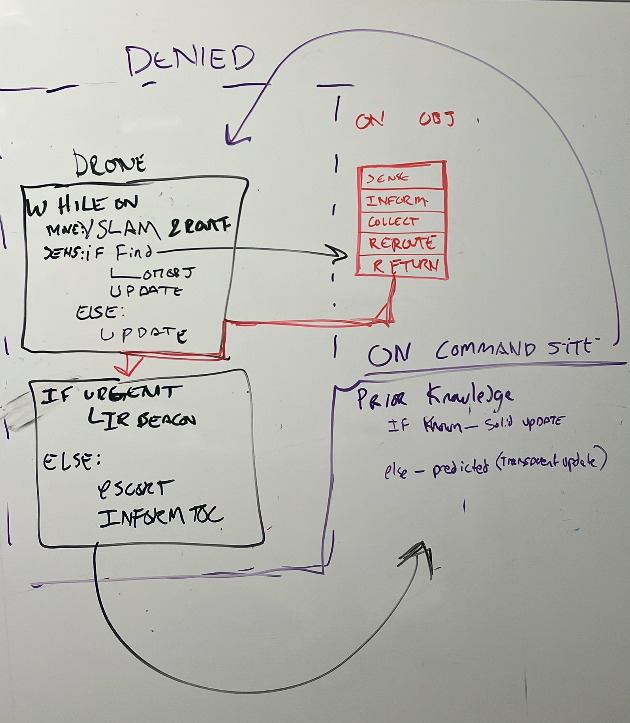
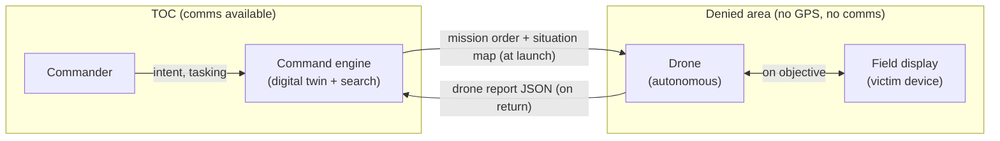
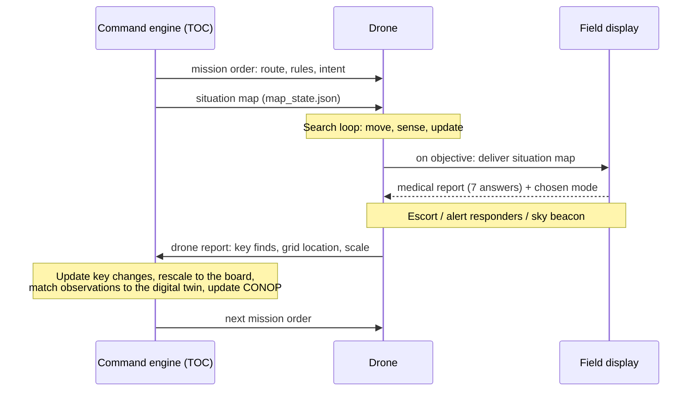
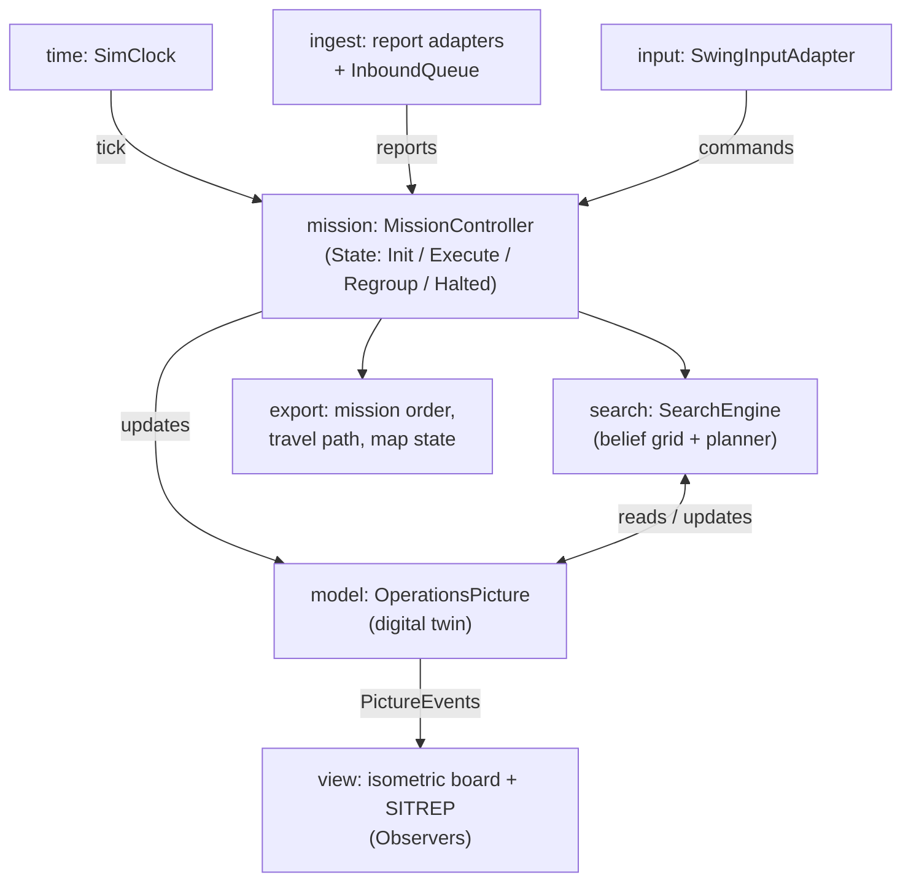
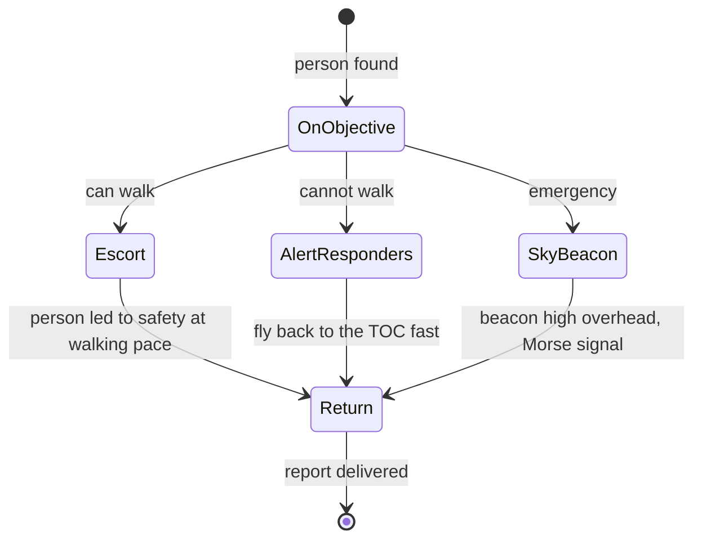
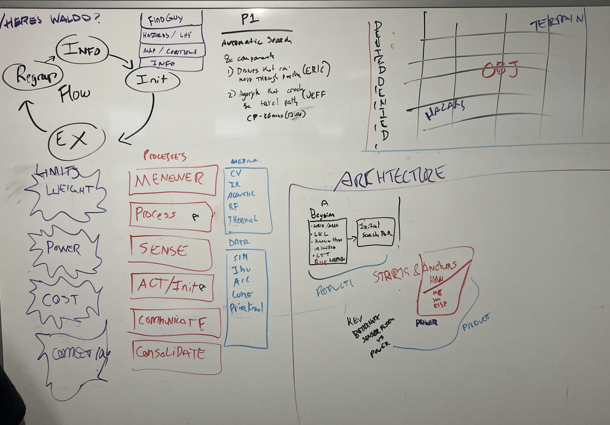
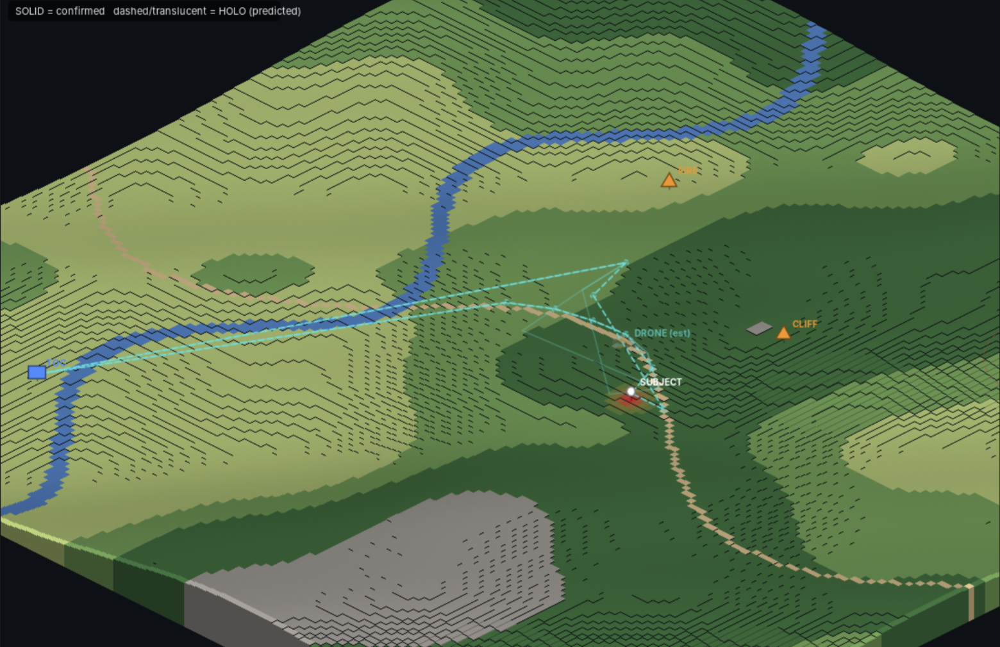
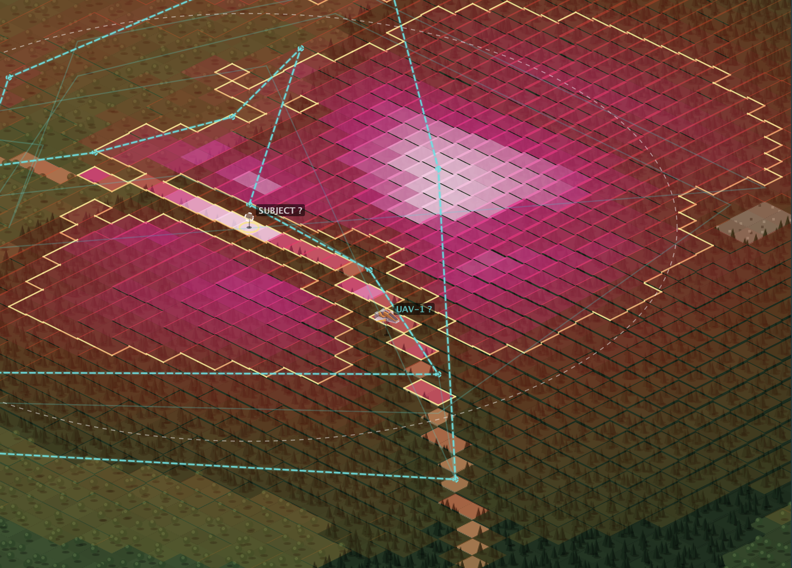

# Operation Lost and Found — Team 20

**Code Metal Forge 2026 · BASE X, Boston · Nov 6–8**

Finding a lost person when GPS, communications, and infrastructure are gone.

Our system pairs an autonomous drone that searches a comms-denied area with a **command picture at the TOC** that plans the search, and a **victim device** that the drone brings to the person: it collects a medical report a child could fill out, shows the person where help is, and carries that information home.

*Operational loop: TOC → drone → on objective → return → TOC.*

---

## Commander's intent

**Purpose.** Locate and assist a lost person inside a GPS- and comms-denied area faster and more safely than a ground search alone, while keeping the rescue team aware of hazards and hostile activity.

**Key tasks.**
1. Plan the search from the best available knowledge: last known location, terrain, how lost people move.
2. Search autonomously, with no link to the TOC once launched.
3. On contact, assess the casualty and act on the spot: escort, alert responders, or mark the location with a sky beacon.
4. Bring everything home and update a shared operations picture that clearly separates confirmed from predicted.

**End state.** The casualty is found, assessed, and either escorted to safety or marked for rescue. The TOC holds an accurate, confirmed picture. No assets are lost to hazards or hostiles.

---

## The problem

- **No GPS.** Everything in the field has to work out where it is from its own sensors.
- **No comms outside the TOC.** Nothing in the search area can send or receive. The drone can't be steered mid-mission and can't report until it physically returns. **The drone is the only link.**
- **Limits:** weight, power, cost, connectivity. The core trade is **sensor fusion vs. power**: more sensing and onboard processing find the person faster but drain the battery faster.

---

## The system

1. **The command engine** at the TOC holds the terrain, the probability map of where the person is, and every known or predicted object. The Bayesian search runs here. It plans each drone's route and packs it, with decision rules, the commander's intent, and the current situation map, into a mission order.
2. **The drone** flies the mission on its own: move, sense, update. On contact it goes **on objective**: sense, inform, collect, decide, return.
3. **The field display** asks seven picture-based medical questions, shows the person a tactical map (their position, the drone, the rescue team, hazards, hostiles, which way help is), and switches mode based on the answers.
4. **On return**, the drone's report updates the picture. Predicted ("holo") objects that the report confirms become solid. The search engine replans.

**The display rule that ties it together:** predicted or planned things are drawn **holo** (translucent, dashed). Things confirmed by a report or a fixed anchor are drawn **solid**. In a comms-denied operation, the commander must always see the difference.

---

## Architecture and UML

### Data pipeline (V3 design)

Every component reads and writes the same small set of JSON contracts, in one shared coordinate frame.

| Contract | Made by | Read by | Holds |
|---|---|---|---|
| Mission order | Command engine | Drone | Route waypoints, decision rules, commander's intent, return deadline |
| Situation map (`map_state.json`) | Command engine | Field display | Positions of the person, drone, team, hazards, hostiles; heading; optional map imagery |
| Medical report | Field display | Drone → command engine | 7 answers (0 SEVERE – 3 FINE), needs-attention list, mode chosen |
| Drone report | Drone | Command engine | Swept squares, sighting, hazards and hostiles seen, medical report, timestamps |

### Command engine structure (C2 picture, Java/Swing)

Patterns adapted from AirCom: the model knows nothing about drawing, projection math stands alone, one digital twin notifies every view, and every outside format enters or leaves through an adapter.

| Pattern | Where | Why |
|---|---|---|
| Observer | Clock → controller; digital twin → views | Time and changes reach everyone who cares, nothing hardwired |
| State | Mission phases, sorties | Behavior changes by phase and over time |
| Adapter | Every file and network edge, keyboard input | Outside formats never leak into the model |
| Strategy | Detection, motion, planning, holo/solid drawing styles | Swappable rules and visuals |
| Facade | `SearchEngine` | One door into the search math (Java engine or GHOST core) |

### Actions on the objective (V3 design)

Decided in the field, at the objective, because there's no one to ask.

Full C2 design, class diagrams, and data contracts: [`c2-picture/README.md`](c2-picture/README.md) on the `c2-picture` branch.

---

## Components

| Component | What it does | Hardware | Status | Where |
|---|---|---|---|---|
| **Field display** (`rescue_app`) | 7 medical questions on a 4-button severity scale, report saved as JSON, tactical situation map, auto-close | Pi 4B + Adafruit PiTFT 2.2" HAT | **v0.5, running on hardware** | *(add branch/folder)* |
| **C2 operations picture** | TOC command engine: isometric terrain board, belief heat map, holo/solid objects, 2-UAV waves, enemy AO, mission orders, report ingest | Laptop (Java/Swing, no external libraries) | **v0.3, running** | `c2-picture` (tags `v0.1-c2` … `v0.3-c2`) |
| **GHOST** | Bayesian search engine (Rust), sensor fusion layer (Python), web dashboard with mission controls | Laptop (stub mode); targets Jetson + Pi 5 | Running in simulation | `ghost`, `ghost-upgrade` |
| **V3 engineer plan** | Data pipeline, command engine changes, actions on objective, field display changes | — | Plan in place | `V3 engineer plan/` on `ghost` |
| **Listener nodes** (`pi_listener`) | Acoustic baseline and anomaly logging, per-node CSV with timestamps | Pi Zero ×5 | Written; waiting on microphones | *(add branch/folder)* |
| **Drone control** | Keyboard and Bluetooth controllers for direct flight tests | Crazyflie 2.1 | Bench-tested; blocked on positioning | *(add branch/folder)* |

### Team

| Who | Focus |
|---|---|
| **Eric** | Drone movement through positions |
| **Jeff** | Search algorithm and travel path (GHOST core, dashboard) |
| **Sebastian** | Systems architecture, UML, C2 command engine, field display |

---

## How the idea evolved

*Day 1 brainstorm whiteboard (CH-1).*

### CH-1 — The brainstorm (Day 1)

Framed as **"Where's Waldo?"** with a mission loop: **INFO → INIT → EXECUTE → REGROUP**.

- Settled on **Bayesian search** for planning: a grid of probabilities, starting from the last known location, where every square searched without a find lowers that square and raises the rest. It's the established method behind Coast Guard search planning, so it's defensible.
- Split the work: drones that move through positions (Eric) and an algorithm that creates the travel path (Jeff), with the waypoint list as the interface between them.
- Wrote down the processes the system must perform (maneuver, process, sense, act, communicate, consolidate) and the sensing options (camera, IR, acoustic, RF, thermal, IMU).
- Defined a seven-layer stack from mission planner down to motor drivers, and flagged **GPS-denied positioning** as the hardest piece.

### Iteration 2 — Hardware reality check

- Got the **Crazyflie 2.1** connected and flying from code over USB and Bluetooth (no radio dongle available), with simple keyboard controllers.
- **Lesson:** without a positioning deck, the drone can lean and climb but can't know where it is, so "fly to waypoint" isn't possible yet. Positioning became the known blocker, and the team's effort shifted toward the parts that make the system work regardless of which vehicle flies it.

### Iteration 3 — Sensing the denied area

- **Dumb nodes, smart center:** cheap sensor nodes stream raw data back (via fiber tether in the full concept); all processing happens at one station.
- **Nature as the sensor:** wildlife and ambient sound react to anything moving through an area. Learn each location's normal, then flag departures from it.
- **Rescuers calibrate it:** the team's own known movements are labeled examples of how the environment reacts to a person passing.
- Scored every idea against the judging criteria. Key insight: **the hackathon floor is a live test environment**, with the crowd standing in for wildlife.
- Built **listener nodes** for five Pi Zeros: noise levels in three pitch bands, synced clocks, no audio stored.

### Iteration 4 — GHOST: the search engine

Jeff built **GHOST**: a Rust core holding the probability grid, likelihood updates from four sensor types, hazard detection, and an information-gain planner, plus a Python sensor layer and a live web dashboard with GO / HALT / RTB controls. The design review surfaced the issues to solve next: repeated readings counted as new evidence, IMU-only drift, and sensor ranges far smaller than a grid square.

### Iteration 5 — The field display

Built on a Pi 4B with the PiTFT 2.2" screen, driven directly over SPI with only libraries already on the Pi. Versioned so every saved report traces to the code that produced it:

| Version | Change |
|---|---|
| v0.1 | First object-oriented build: 5 questions, tap to answer, hold to go back or skip, reports saved safely to JSON |
| v0.2 | Seven questions ordered most life-threatening first. New icons. Version numbers in every report. |
| v0.3 | "Safe to move?" redesigned to show danger: fire, predator, hostile person |
| v0.4 | REPORT COLLECTED screen with countdown, report stamped as collected, app closes |
| v0.5 | Tactical situation map: pixel display centered on the person, blinking military-convention symbols, range rings, compass, SITREP panel, 20 s "drone returning" countdown |

### Iteration 6 — Designing the C2 operations picture

The whiteboard mission flow led to the central design decision: **everything outside the TOC is comms-denied, so the drone is the only link.**

- **The TOC board is where the search algorithm lives.** It informs the drone's plan and is informed by every return.
- **Holo vs. solid** shows predicted vs. confirmed at a glance. Confirmed moving objects fade back to holo as they age.
- **Board spec:** a 5 × 5 mile area at 50 m per square (162 × 162), isometric tiles, terrain drawn once and reused.
- **Terrain per square** organized with OAKOC: ground cover, canopy, trails, water, structures, height, slope, cliffs. Terrain feeds the search itself.
- **Architecture** adapted from AirCom: digital twin, standalone projection math, Observer-driven views, adapters at every edge.

### Iteration 7 — Building the C2 operations picture

Built and run end to end, about 60 Java classes with no external libraries. Each version is tagged in git.

| Version | Change |
|---|---|
| v0.1 | First end-to-end build: clock, digital twin, State-pattern mission loop, drone report inbox, simulated drone, mission order / travel path / map state writers, isometric board with holo/solid styles |
| v0.2 | Satellite-style terrain with trees and textures, enemy AO with six hostiles and a moving patrol, hostiles confirmed by drone sightings, stronger heat map with contour and peak ring, 4th zoom level, redesigned dashboard |
| v0.3 | 2 UAVs per wave instead of 3, so routes and drones are easier to follow |

| v0.1 | v0.2 |
|---|---|
|  |  |

### Iteration 8 — V3 plan: closing the loop (next)

*V3 plan: data pipeline, command engine, sim TOC changes, field display changes.*

- **Data pipeline:** the drone returns a JSON report of key finds, grid location, and scale. The command engine updates key changes, rescales observations onto the board, matches them to the digital twin, and updates the CONOP. That feeds both the drone's next route and the field display's situation picture.
- **Actions on the objective, decided in the field:** **escort** if the person can walk (pace and path), **alert responders** if they can't (the drone flies back to the TOC), **sky beacon** in an emergency (the drone climbs high overhead and signals in Morse code).
- **Sim TOC changes:** strip the dashboard down to what the commander needs, and add the three objective actions to the mission loop.
- **Field display changes:** switch mode from the medical answers, and receive map updates whose situation picture matches the sim, from the same JSON.

---

## Sandbox: scaling the sim to the real floor

*The test floor at BASE X: markers placed on the floor and the ground robot test platform.*

The hackathon floor is our physical sandbox. The plan is to map it into the command engine at a known scale, so positions measured on the floor land on the right squares of the board. That's the **impose / rescale** step in the data pipeline: the same code that converts a drone's report into board squares converts floor measurements, so the sim and the room roughly match, and a live demo on the floor shows up live on the TOC board.

---

## Hardware in use

| Hardware | Role |
|---|---|
| Raspberry Pi 4B + Adafruit PiTFT 2.2" HAT (ILI9340, 320×240, 4 buttons) | Field display |
| Raspberry Pi 5 + Raspberry Pi AI HAT (Hailo) | Onboard AI candidate (setup paused) |
| Raspberry Pi Zero ×5 | Listener nodes |
| Crazyflie 2.1 | Flight testing (no positioning deck, no radio dongle) |
| Ground robot test platform | Sandbox floor testing |
| Seeed reSpeaker Flex XVF3800 (4-mic ring) | Direction-of-arrival listening, candidate for listener nodes |
| Grove sensor kits, Arduino | Available sensors |
| Laptops | Command engine (C2 picture), GHOST core and dashboard |

---

## Open items

- **V3 build:** actions on the objective in both the command engine and the field display; the situation-map hop from the TOC to the field display; sandbox floor mapping and scale.
- **Sky beacon decisions:** visible or infrared (visible light also marks the casualty for hostiles), and whether the Morse signal carries SOS only or the casualty's grid location.
- **Escort decisions:** destination (TOC, landing zone, or rally point), and a walking route from terrain walk cost that avoids hazards and the enemy AO.
- **Drone positioning:** a positioning deck or visual odometry, so the drone can fly to waypoints.
- **GHOST:** stop counting repeated readings as new evidence, coverage-based detection per square, terrain-driven movement between returns; agree on mission-order and drone-report formats with the command engine.
- **Terrain prep:** imagery + elevation → `terrain.json`, replacing the generated terrain.
- **Listener nodes:** USB microphones for the Pi Zeros.

---

## Credits

Open-source assets used in the C2 picture are listed in `c2-picture/assets/CREDITS.md` (Kenney, CC0). All other symbols are drawn in code.
