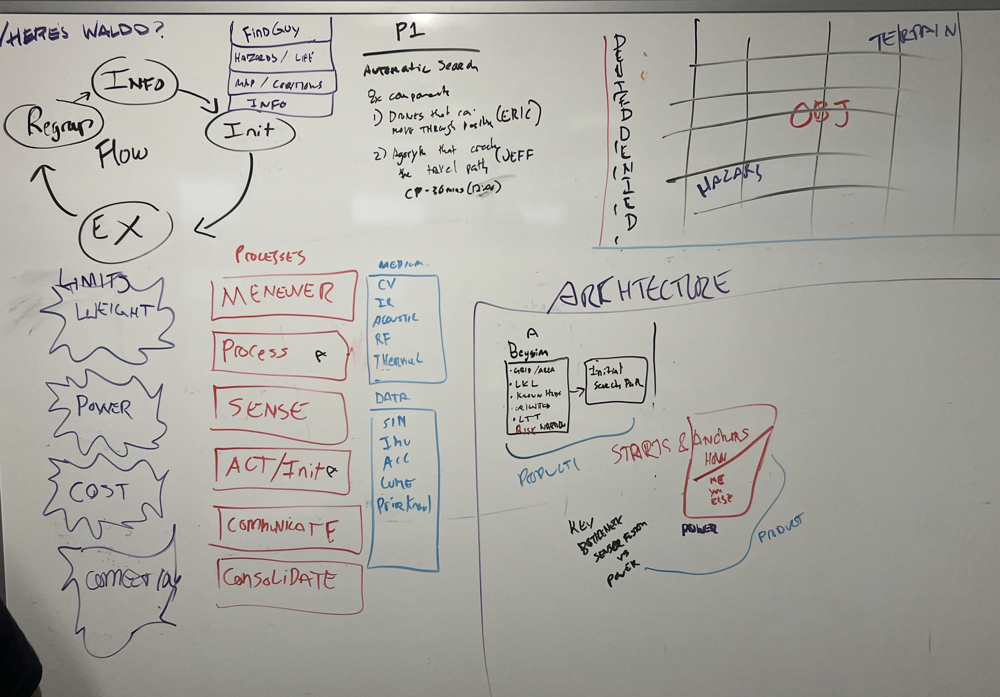
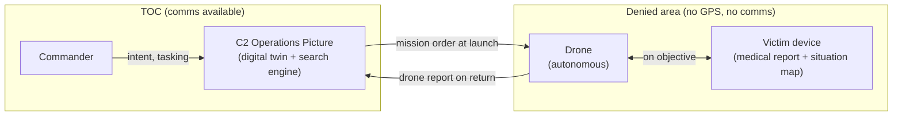

# Operation Lost and Found — Team 20

**Code Metal Forge 2026 · BASE X, Boston · Nov 6–8**

Finding a lost person when GPS, communications, and infrastructure are gone.

Our system pairs an autonomous drone that searches a comms-denied area with a **command picture at the TOC** that plans the search, and a **victim device** that the drone brings to the person: it collects a medical report a child could fill out, shows the person where help is, and carries that information home.

*Day 1 brainstorm whiteboard (CH-1). Where it started; see "How the idea evolved" below.*

---

## The problem

- **No GPS.** Everything in the field has to work out where it is from its own sensors.
- **No comms outside the TOC.** Nothing in the search area can send or receive. The drone can't be steered mid-mission and can't report until it physically returns.
- **Limits:** weight, power, cost, connectivity. The core trade is **sensor fusion vs. power**: more sensing and onboard processing find the person faster but drain the battery faster.

---

## The system today

1. **The C2 operations picture** holds the terrain, the probability map of where the person is, and every known or predicted object. The Bayesian search runs here. It plans the drone's route and packs it, with decision rules and the commander's intent, into a mission order.
2. **The drone** flies the mission on its own: move, sense, update. When it finds the person, it goes **on objective**: sense, inform, collect, reroute, return.
3. **The victim device** asks seven picture-based medical questions, shows the person a tactical map (their position, the drone, the rescue team, hazards, hostiles, which way help is), then counts down while the drone returns.
4. **On return**, the drone's report updates the picture. Predicted ("holo") objects that the report confirms become solid. The search engine replans.

**The display rule that ties it together:** predicted or planned things are drawn **holo** (translucent, dashed paths). Things confirmed by a report or a fixed anchor are drawn **solid**. In a comms-denied operation, the commander must always see the difference.

---

## Components

| Component | What it does | Hardware | Status | Where |
|---|---|---|---|---|
| **Victim device** (`rescue_app`) | 7 medical questions with a 4-button severity scale, report saved as JSON, tactical situation map, auto-close | Pi 4B + Adafruit PiTFT 2.2" HAT | **v0.5, running on hardware** | *(add branch/folder)* |
| **GHOST** | Bayesian search engine (Rust), sensor fusion layer (Python), web dashboard with mission controls | Laptop (stub mode); targets Jetson + Pi 5 | Running in simulation | `ghost`, `ghost-upgrade` |
| **C2 operations picture** | TOC game board: terrain, belief grid, holo/solid objects, mission orders, report ingest | Laptop (Java/Swing) | **Design complete**, build next | `c2-picture` |
| **Listener nodes** (`pi_listener`) | Acoustic baseline and anomaly logging, per-node CSV with timestamps | Pi Zero ×5 | Written; waiting on microphones | *(add branch/folder)* |
| **Drone control** | Keyboard and Bluetooth controllers for direct flight tests | Crazyflie 2.1 | Bench-tested; blocked on positioning | *(add branch/folder)* |

### Team

| Who | Focus |
|---|---|
| **Eric** | Drone movement through positions |
| **Jeff** | Search algorithm and travel path (GHOST core, dashboard) |
| **Sebastian** | Systems architecture, UML, C2 picture design, victim device |

---

## How the idea evolved

### CH-1 — The brainstorm (Day 1)

Framed as **"Where's Waldo?"** with a mission loop: **INFO → INIT → EXECUTE → REGROUP**.

- Settled on **Bayesian search** for planning: a grid of probabilities, starting from the last known location, where every square searched without a find lowers that square and raises the rest. It's the established method behind Coast Guard search planning, so it's defensible.
- Split the work: drones that move through positions (Eric) and an algorithm that creates the travel path (Jeff), with the waypoint list as the interface between them.
- Wrote down the processes the system must perform (maneuver, process, sense, act, communicate, consolidate) and the sensing options (camera, IR, acoustic, RF, thermal, IMU).
- Defined a seven-layer stack from mission planner down to motor drivers, and flagged **GPS-denied positioning** as the hardest piece.

### Iteration 2 — Hardware reality check

- Got the **Crazyflie 2.1** connected and flying from code over USB and Bluetooth (no radio dongle available), with simple keyboard controllers.
- **Lesson:** without a positioning deck, the drone can lean and climb but can't know where it is, so "fly to waypoint" isn't possible yet. Positioning became the known blocker, and the team's effort shifted toward the parts that make the system work regardless of which vehicle flies it.

### Iteration 3 — Sensing the denied area

Brainstormed what can find a person over a wide area with almost no infrastructure:

- **Dumb nodes, smart center:** cheap sensor nodes stream raw data back (via fiber tether in the full concept); all processing happens at one station.
- **Nature as the sensor:** wildlife and ambient sound react to anything moving through an area. Learn each location's normal, then flag departures from it.
- **Rescuers calibrate it:** the team's own known movements are labeled examples of how the environment reacts to a person passing. Subtract them from the picture, and learn their signature.
- Scored every idea against the judging criteria (real-world evidence, live demo, deployability, ideation). Key insight: **the hackathon floor is a live test environment**, with the crowd standing in for wildlife.
- Built **listener nodes** for five Pi Zeros: noise levels in three pitch bands, synced clocks, no audio stored.

### Iteration 4 — GHOST: the search engine

Jeff built **GHOST**: a Rust core holding the probability grid, likelihood updates from four sensor types, hazard detection, and an information-gain planner, plus a Python sensor layer and a live web dashboard with GO / HALT / RTB controls.

The design review and a full simulation run surfaced the issues to solve next:
- **Repeated readings counted as new evidence** made the map overconfident. One run declared contact about 10 m from the true position.
- **IMU-only position tracking drifts** badly. Visual odometry on the Jetson path fixes this.
- **Sensor ranges (3–20 m) are much smaller than a grid square,** so detection has to account for how much of a square was actually swept.

### Iteration 5 — The victim device

Built on a Pi 4B with the PiTFT 2.2" screen, driven directly over SPI with only libraries already on the Pi (no internet needed on site). Versioned so every saved report traces to the code that produced it:

| Version | Change |
|---|---|
| v0.1 | First object-oriented build: 5 questions, tap to answer, hold to go back or skip, reports saved safely to JSON |
| v0.2 | Seven questions ordered most life-threatening first: blood loss, breathing, head wound, cold, walking, arms, safe to move. New icons. Version numbers in every report. |
| v0.3 | "Safe to move?" redesigned to show danger: fire, predator, hostile person |
| v0.4 | REPORT COLLECTED screen with countdown, report stamped as collected, app closes |
| v0.5 | Tactical situation map: pixel-style display centered on the person, blinking military-convention symbols (friendly rectangle, hostile diamond, hazard triangle), range rings, compass, SITREP panel, and a 20 s "drone returning" countdown. Reads real positions, heading, and map imagery when supplied; estimates otherwise. |

**The medical answers drive the mission:** a SEVERE answer on bleeding, breathing, head, or cold makes the case urgent. Being able to walk and safe to move makes escort possible.

### Iteration 6 — The C2 operations picture

The whiteboard mission flow (drone loop → on objective → urgent or escort → return → TOC updates its prior knowledge) led to the central design decision: **everything outside the TOC is comms-denied, so the drone is the only link.** That reframed the whole system:

- **The TOC board is where the search algorithm lives.** It informs the drone's plan and is informed by every drone return.
- **Holo vs. solid** shows predicted vs. confirmed at a glance. Known positions fade toward prediction as they age.
- **Board spec:** a 5 × 5 mile area at 50 m per square (162 × 162), three zoom levels, isometric tiles, terrain drawn once and reused.
- **Terrain per square:** ground cover, canopy, roads and trails, water, structures, plus computed height, slope, cliff flags, drainages, and landing zones, organized with OAKOC. Terrain feeds the search itself: lost people follow trails and drainages, heavy canopy hides them from sensors, and cliffs and water block movement.
- **Architecture** adapted from AirCom (Java/Swing): a digital-twin model, standalone projection math, Observer-driven views, and input kept out of the model.

Full design, UML, and data contracts: [`c2-picture/README.md`](c2-picture/README.md) on the `c2-picture` branch.

---

## Hardware in use

| Hardware | Role |
|---|---|
| Raspberry Pi 4B + Adafruit PiTFT 2.2" HAT (ILI9340, 320×240, 4 buttons) | Victim device |
| Raspberry Pi 5 + Raspberry Pi AI HAT (Hailo) | Onboard AI candidate (setup paused) |
| Raspberry Pi Zero ×5 | Listener nodes |
| Crazyflie 2.1 | Flight testing (no positioning deck, no radio dongle) |
| Seeed reSpeaker Flex XVF3800 (4-mic ring) | Direction-of-arrival listening, candidate for listener nodes |
| Grove sensor kits, Arduino | Available sensors |
| Laptops | GHOST core and dashboard, C2 picture |

---

## Open items

- **Drone positioning:** a positioning deck or visual odometry, so the drone can fly to waypoints.
- **GHOST:** stop counting repeated readings as new evidence, coverage-based detection per square, terrain-driven movement between returns.
- **C2 picture:** build the Swing board, terrain prep (imagery + elevation → `terrain.json`), and agree on mission-order and drone-report message formats with the GHOST core.
- **Decisions pending:** does a confirmed moving object fade back to holo over time; can the drone leave a marker with an urgent casualty; what REROUTE means on objective; when a drone counts as overdue.
- **Listener nodes:** USB microphones for the Pi Zeros.

---

## Credits

Open-source assets used in the C2 picture are listed in `c2-picture/assets/CREDITS.md` (Kenney, CC0). All other symbols are drawn in code.
