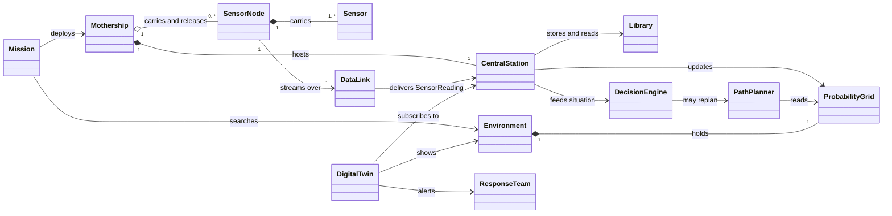
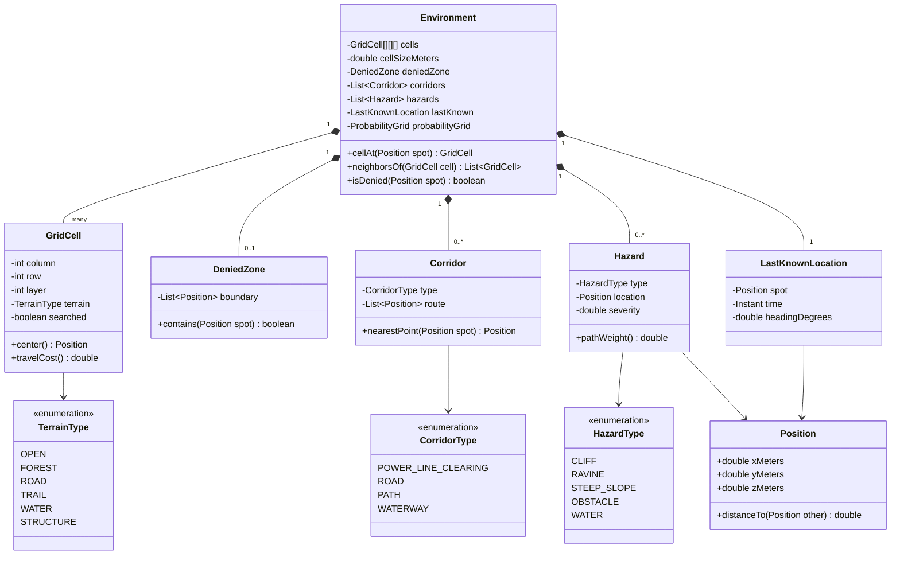
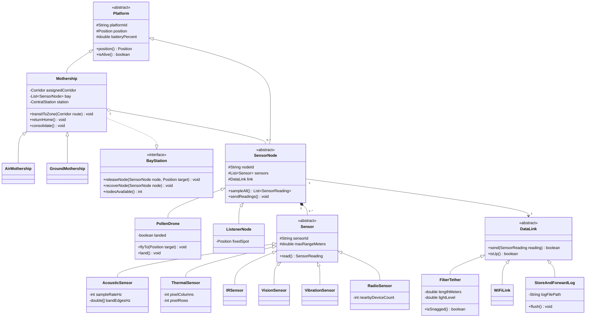
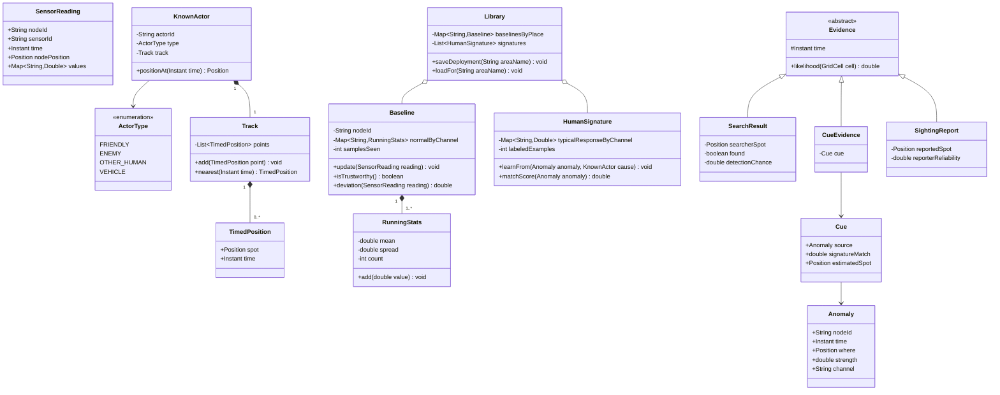
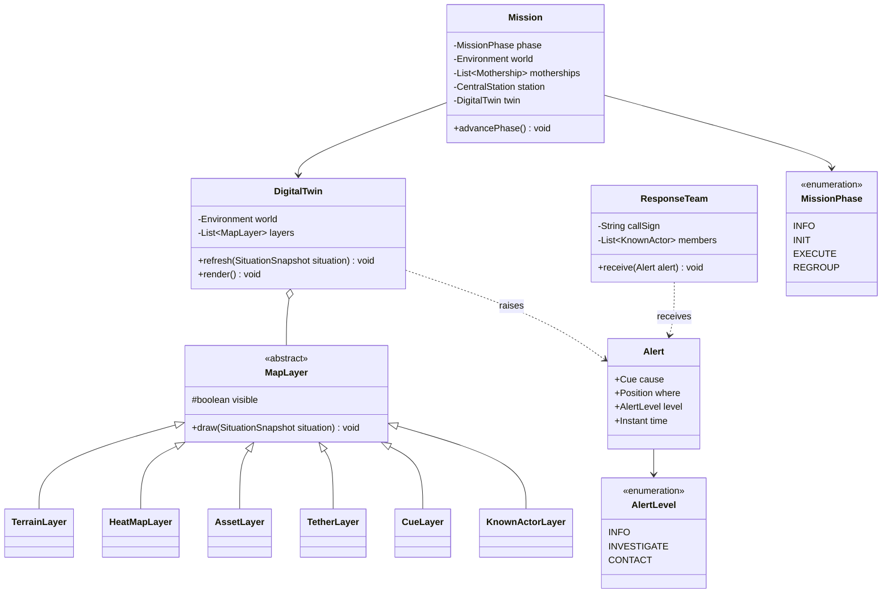

# Operation Lost and Found — UML Class Design (draft)

Built from the brainstorm: denied environment, motherships on corridors, dumb sensor nodes on tethers, nature-as-sensor anomaly detection, rescuers as calibration, Bayesian heat map, digital twin for the response team.

Diagrams render on GitHub. Notation:

| Arrow | Meaning | Read it as |
|---|---|---|
| `<\|--` | Inheritance | "is a kind of" |
| `..\|>` | Implements an interface | "can play the role of" |
| `*--` | Composition | "owns, and it dies with me" |
| `o--` | Aggregation | "holds, but it can exist without me" |
| `-->` | Association | "uses / knows about" |
| `..>` | Dependency | "reads or produces, briefly" |

`+` public, `-` private, `#` protected (visible to subclasses).

---

## 1. Overview — who talks to whom

Members left out so the shape is visible. Sections 2–6 fill in each part.

---

## 2. Environment — the world being searched

---

## 3. Platforms, nodes, sensors, links — the physical things

`BayStation` is modeled as a **role** (interface) the `Mothership` plays, not a separate object. That matches "the mothership has three responsibilities."

**Real-world mapping this weekend:** a Pi Zero listener = `ListenerNode` + `AcousticSensor` + `StoreAndForwardLog` (logs to SD, collected later). A fiber-tethered micro drone = `PollenDrone` + sensors + `FiberTether`.

---

## 4. Data and evidence — what flows

The key contract: **every `Evidence` answers one question** — *"how likely would I see this if the person were in this cell?"* That single method is what lets any source feed the Bayesian map.

---

## 5. Processing — the central station's brain

Dumb nodes, smart center: every computation lives here.

```mermaid
classDiagram
    class CentralStation {
        -Map~String,Baseline~ baselines
        -List~KnownActor~ knownActors
        -BaselineBuilder baselineBuilder
        -AnomalyDetector anomalyDetector
        -KnownActorFilter knownActorFilter
        -SignatureMatcher signatureMatcher
        -CorrelationEngine correlationEngine
        -BayesianUpdater bayesianUpdater
        +receive(SensorReading reading) void
        +snapshot() SituationSnapshot
    }
    class BaselineBuilder {
        +update(Baseline baseline, SensorReading reading) void
    }
    class AnomalyDetector {
        -double deviationThreshold
        +check(SensorReading reading, Baseline baseline) Optional~Anomaly~
    }
    class KnownActorFilter {
        -double explainRadiusMeters
        +explainedBy(Anomaly anomaly, List~KnownActor~ actors) Optional~KnownActor~
    }
    class SignatureMatcher {
        -HumanSignature signature
        +train(Anomaly anomaly, KnownActor cause) void
        +toCue(Anomaly anomaly) Cue
    }
    class CorrelationEngine {
        -List~Anomaly~ recent
        +add(Anomaly anomaly) void
        +movingDisturbances() List~Track~
    }
    class ProbabilityGrid {
        -double[][] chanceByCell
        +chanceAt(GridCell cell) double
        +hottestCells(int count) List~GridCell~
        +entropy() double
        +normalize() void
    }
    class BayesianUpdater {
        +apply(Evidence evidence, ProbabilityGrid grid) void
        +spreadOverTime(ProbabilityGrid grid, MotionModel walker, Duration elapsed) void
    }
    class MotionModel {
        <<interface>>
        +moveChance(GridCell from, GridCell to, Duration elapsed) double
    }
    class LostPersonMotion {
        -double walkingSpeed
        -boolean prefersDownhill
        -boolean prefersTrails
    }
    class SituationSnapshot {
        +ProbabilityGrid grid
        +List~Cue~ recentCues
        +List~Hazard~ hazards
        +List~Platform~ assets
    }
    class Trigger {
        <<interface>>
        +isMet(SituationSnapshot situation) boolean
        +fire(DecisionEngine engine) void
    }
    class CueNearCorridorTrigger
    class NodeLostTrigger
    class ConvergenceTrigger
    class DecisionEngine {
        -List~Trigger~ armedTriggers
        +evaluate(SituationSnapshot situation) void
    }
    class PathPlanner {
        +nextWaypoint(ProbabilityGrid grid, Environment world, Platform searcher) GridCell
    }

    CentralStation *-- BaselineBuilder
    CentralStation *-- AnomalyDetector
    CentralStation *-- KnownActorFilter
    CentralStation *-- SignatureMatcher
    CentralStation *-- CorrelationEngine
    CentralStation *-- BayesianUpdater
    CentralStation ..> SituationSnapshot : produces
    BayesianUpdater ..> ProbabilityGrid : updates
    BayesianUpdater --> MotionModel
    MotionModel <|.. LostPersonMotion
    Trigger <|.. CueNearCorridorTrigger
    Trigger <|.. NodeLostTrigger
    Trigger <|.. ConvergenceTrigger
    DecisionEngine o-- Trigger
    DecisionEngine ..> SituationSnapshot : reads
    DecisionEngine --> PathPlanner
```

**Flow of one reading:**
`SensorReading` → `BaselineBuilder` (learn normal) → `AnomalyDetector` (odd?) → `KnownActorFilter` (explained by us?) — if yes → `SignatureMatcher.train` (calibration); if no → `SignatureMatcher.toCue` → `CueEvidence` → `BayesianUpdater.apply` → `ProbabilityGrid` → `DecisionEngine` checks triggers.

---

## 6. Command picture and mission — the humans and the loop

---

## Design notes and open questions

1. **`Evidence.likelihood(cell)` is the central contract.** Any new source (a drone sweep, a listener cue, a human report) plugs into the map by implementing it. The hard one is `CueEvidence`, whose number comes from the `HumanSignature` calibration.
2. **Rescuers are double-use data.** `KnownActorFilter` both removes our own disturbance and hands labeled examples to `SignatureMatcher.train`.
3. **`BayStation` is a role, not a thing.** Change it to a class only if bay stations can exist apart from a mothership.
4. **Repeated readings must not count as fresh evidence.** `BayesianUpdater` needs a rule for correlated evidence (same sensor, same spot, short interval). The GHOST stub demo converged ~10 m off the subject partly for this reason.
5. **Triggers, not schedules.** `DecisionEngine` holds armed `Trigger`s; the environment's state decides when they fire (core idea 2).

### Mapping to Jeff's GHOST code

| This design | GHOST |
|---|---|
| `ProbabilityGrid` | `belief_map.rs` |
| `Evidence` / `likelihood` | `sensor_model.rs` (Pd / Pfa likelihood ratios) |
| `BayesianUpdater` | update + normalize inside the core |
| `PathPlanner` | `path_planner.rs` |
| `Hazard` | `hazard.rs` |
| `DigitalTwin` | `dashboard/index.html` |
| `Sensor` subclasses | `sensors/*.py` |
| Not yet in GHOST | `Baseline`, `AnomalyDetector`, `KnownActorFilter`, `HumanSignature`, `CorrelationEngine`, `MotionModel`, `DecisionEngine`, `ListenerNode` |
